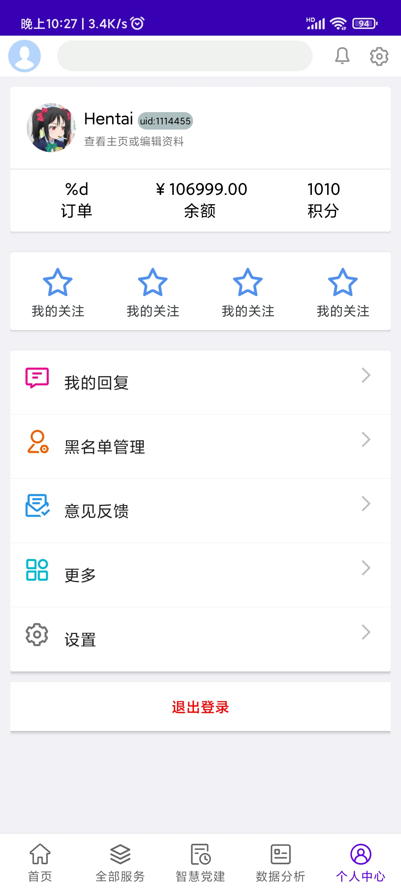
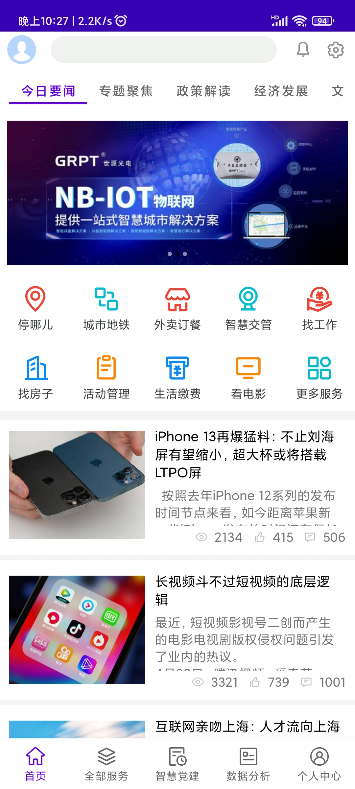

# SmartCity 智慧城市

基于智慧城市平台 Open API v2.0 的 Android 客户端应用，为市民提供新闻资讯、停车服务、钱包积分等一站式城市服务。


 

### 核心亮点
- **模块化设计**：首页、服务、停车、党建、数据分析五大模块，职责清晰
- **MVVM + Repository 架构**：ViewModel 暴露 LiveData，Repository 封装 MutableLiveData，通过 ServiceFactory 单例获取 Retrofit API 实例。UI 层仅负责观察数据，无需关心网络请求与数据转换细节，实现视图与业务逻辑的充分解耦
- **RESTful API**：标准化接口设计，Token 认证机制保障安全
- **Material Design**：遵循 Google Material 设计规范，提供流畅的用户体验

### 版本信息
- 当前版本：v1.0
- 最低支持：Android 5.1 (API 22)
- 目标版本：Android 12 (API 31)

## 技术栈

| 类别     | 技术                                             |
| -------- | ------------------------------------------------ |
| 语言     | Java 8                                           |
| 平台     | Android (minSdk 22, targetSdk 31)                |
| 构建工具 | Gradle 7.0.4                                     |
| 架构模式 | MVVM (Model-View-ViewModel) + Repository         |
| 网络请求 | Retrofit 2 + OkHttp 4 + Gson                     |
| 图片加载 | Glide 4.12                                       |
| 图表     | MPAndroidChart v3.1.0                            |
| 轮播图   | YouthBanner 1.4.10                               |
| UI组件   | AndroidX, Material Design, ViewPager2, TabLayout |

## 功能模块

### 首页
- 新闻资讯分类浏览（ViewPager2 + TabLayout）
- 轮播图展示
- 新闻搜索
- 新闻点赞、评论

### 全部服务
- 城市地铁、外卖订餐、智慧交管
- 找房子、找工作、活动管理
- 生活缴费、看电影等

### 停哪儿（停车模块）
- 停车场浏览（轮播图 + 列表）
- 停车记录查询（按时间、停车场、车牌筛选）
- 车辆管理（添加、修改、删除）
- 里程油耗记录
- 钱包充值、积分兑换
- 积分排行

### 个人中心
- 用户登录/退出
- 个人信息查看与修改
- 余额与积分管理
- 我的评论、反馈、设置

## 项目结构

```
app/src/main/java/com/example/smartcity04/
├── adapter/       # RecyclerView 适配器
├── dialog/        # 弹窗（充值、积分排行、车辆管理等）
├── fragment/      # Fragment（首页、个人中心、服务）
├── network/       # Retrofit API 接口 + ServiceFactory
├── pojo/          # 数据模型（POJO）
├── repository/    # 数据仓库层
├── ui/            # Activity
│   └── stopwhere/ # 停车模块页面
├── util/          # 工具类
├── viewmodels/    # ViewModel 层
└── MainActivity.java
```

## 软件架构

采用 **MVVM + Repository** 分层架构，以 LiveData 作为响应式数据载体，实现 UI 层与数据层的解耦。

### 架构总览

```
┌─────────────────────────────────────────────────────────────┐
│  UI 层                                                      │
│  Activity / Fragment / Dialog                               │
│  observe(LiveData) 观察数据变化，自动刷新界面                 │
└─────────────────────┬───────────────────────────────────────┘
                      │ LiveData<T>
┌─────────────────────▼───────────────────────────────────────┐
│  ViewModel 层                                               │
│  BasicViewModel — 通用业务（新闻、用户、账单）                │
│  StopWhereViewModel — 停车业务（停车场、车辆、积分）          │
│  暴露 LiveData 接口，管理页面生命周期感知的数据                │
└─────────────────────┬───────────────────────────────────────┘
                      │
┌─────────────────────▼───────────────────────────────────────┐
│  Repository 层                                              │
│  BasicRepository — 持有 MutableLiveData，调用 API 后 setValue│
│  StopWhereRepo — 停车数据仓库，含 18 个 LiveData 字段         │
│  负责数据获取、转换与缓存，屏蔽网络细节                         │
└─────────────────────┬───────────────────────────────────────┘
                      │ Call<T>.enqueue()
┌─────────────────────▼───────────────────────────────────────┐
│  Network 层                                                 │
│  ServiceFactory — Retrofit 单例工厂（baseUrl + OkHttp + Gson） │
│  BasicApi — 通用接口（新闻、用户、账单、上传）                 │
│  StopWhereApi — 停车接口（停车场、车辆、积分、商品）           │
│  EnqueueCallback — 统一错误处理抽象类                         │
└─────────────────────┬───────────────────────────────────────┘
                      │ HTTP (cleartext)
┌─────────────────────▼───────────────────────────────────────┐
│  后端服务 http://:10001/                                     │
│  RESTful JSON API，Open API v2.0                            │
└─────────────────────────────────────────────────────────────┘
```

### 数据流

```
  用户操作
      │
      ▼
  Activity/Fragment
      │ viewModel.getXxx().observe(this, callback)
      ▼
  ViewModel
      │ repo.getXxx()
      ▼
  Repository
      │ service.getXxx().enqueue(callback)
      ▼
  Retrofit API (HTTP 请求)
      │
      ▼
  后端响应 JSON
      │ Gson 反序列化为 RequestRows<T> / RequestData<T> 等
      ▼
  MutableLiveData.setValue(data)
      │
      ▼
  UI 自动更新 (LiveData 观察者回调)
```

### 网络层

**ServiceFactory** (`network/ServiceFactory.java`) — Retrofit 单例工厂：

```
Retrofit.Builder
  .baseUrl("http://124.93.196.45:10001/")
  .client(OkHttpClient: 10s 超时)
  .addConverterFactory(GsonConverterFactory.create())
```

- 不使用 OkHttp Interceptor 注入 Token
- 每个需要认证的请求通过 `@Header("Authorization")` 手动传入 Token

**API 响应封装类型：**

| 类型              | JSON 数据字段        | 用途                     |
| ----------------- | -------------------- | ------------------------ |
| `RequestData<T>`  | `"data"` (List)      | `getCategory()`          |
| `RequestRows<T>`  | `"rows"` + `"total"` | 多数列表接口             |
| `RequestToken<T>` | `"token"`            | `login()` 登录响应       |
| `RequestUser<T>`  | `"user"`             | `getUserInfo()` 用户信息 |
| `RequestMessage`  | `"msg"` + `"code"`   | 写操作接口（增删改）     |

### 认证流程

```
登录: LoginActivity
  → BasicApi.login(username, password)
  → 后端返回 RequestToken(token)
  → SharedPreferences 存储 token
  → CommonUtil.getToken(context) 读取 token

请求: Activity/Fragment
  → token = CommonUtil.getToken(context)
  → viewModel.getXxx(token)
  → repository.service.getXxx(token)
  → @Header("Authorization") token  → HTTP 请求

登出: UserHomeFragment
  → SharedPreferences.edit().clear()
  → UI 切回登录卡片
```

**Token 存储**：`SharedPreferences("smart_city_user_token")`，键名 `"token"`、`"username"`、`"password"`。

### 核心类关系

| 层         | 类                    | 职责                                                |
| ---------- | --------------------- | --------------------------------------------------- |
| UI         | `MainActivity`        | 底部导航宿主，管理 5 个 Fragment                    |
| UI         | `HomeFragment`        | 首页：新闻分类 Tab + ViewPager2                     |
| UI         | `UserHomeFragment`    | 个人中心：登录态切换、用户信息展示                  |
| UI         | `StopWhereActivity`   | 停车模块入口：轮播 + 停车场列表                     |
| ViewModel  | `BasicViewModel`      | 持有 `BasicRepository`，暴露 12 个 LiveData         |
| ViewModel  | `StopWhereViewModel`  | 持有 `StopWhereRepo`（static），暴露 18 个 LiveData |
| Repository | `BasicRepository`     | 调用 `BasicApi`，通过 `MutableLiveData` 回调        |
| Repository | `StopWhereRepo`       | 调用 `StopWhereApi`，同模式                         |
| Utility    | `CommonUtil`          | Token 读取、Toast、顶部栏、键盘隐藏等               |
| Utility    | `SmContext`           | 常量接口：SharedPreferences 文件名、Intent Key 等   |
| Callback   | `RefreshDataListener` | 弹窗通知父页面刷新数据的回调接口                    |

## 构建运行

### 环境要求
- Android Studio Arctic Fox 及以上
- JDK 8+
- Android SDK 31

### 构建步骤
1. 使用 Android Studio 打开项目目录
2. 等待 Gradle 同步完成
3. 连接 Android 设备或启动模拟器（API 22+）
4. 运行 `gradlew assembleDebug` 或点击 Run

### 签名配置
Release 版本使用签名文件 `smart-city-test2.jks`，配置位于 `app/build.gradle` 的 `signingConfigs` 中。

## API 接口

基础地址：`http://:10001/`

### 通用接口 (BasicApi)
| 方法 | 路径                                | 说明         |
| ---- | ----------------------------------- | ------------ |
| GET  | `/prod-api/press/category/list`     | 新闻分类     |
| GET  | `/prod-api/api/rotation/list`       | 首页轮播图   |
| GET  | `/prod-api/press/press/list`        | 新闻列表     |
| GET  | `/prod-api/press/comments/list`     | 新闻评论     |
| POST | `/prod-api/press/pressComment`      | 发表评论     |
| POST | `/prod-api/api/login`               | 用户登录     |
| GET  | `/prod-api/api/common/user/getInfo` | 获取用户信息 |
| PUT  | `/prod-api/api/common/user`         | 修改用户信息 |
| POST | `/prod-api/api/common/feedback`     | 提交反馈     |
| POST | `/prod-api/common/upload`           | 文件上传     |

### 停车接口 (StopWhereApi)
| 方法   | 路径                                           | 说明       |
| ------ | ---------------------------------------------- | ---------- |
| GET    | `/prod-api/api/park/lot/list`                  | 停车场列表 |
| GET    | `/prod-api/api/park/lot/record/list`           | 停车记录   |
| GET    | `/prod-api/api/park/car/my`                    | 我的车辆   |
| POST   | `/prod-api/api/park/car`                       | 添加车辆   |
| PUT    | `/prod-api/api/park/car`                       | 修改车辆   |
| DELETE | `/prod-api/api/park/car/{id}`                  | 删除车辆   |
| GET    | `/prod-api/api/park/recharge/list`             | 充值记录   |
| POST   | `/prod-api/api/park/recharge/pay`              | 充值       |
| GET    | `/prod-api/api/park/score/list`                | 积分记录   |
| GET    | `/prod-api/api/park/score/top/list`            | 积分排行   |
| GET    | `/prod-api/api/park/product/list`              | 积分商品   |
| POST   | `/prod-api/api/park/score/consume/{productId}` | 积分兑换   |

## 许可证

MIT License
