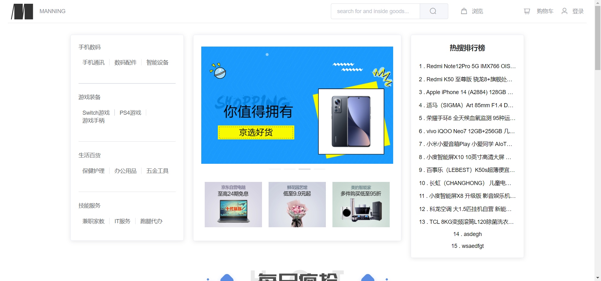
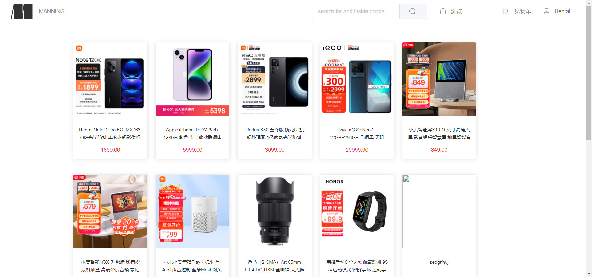
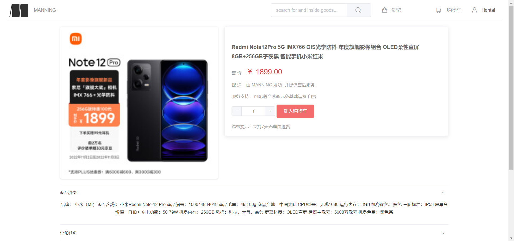
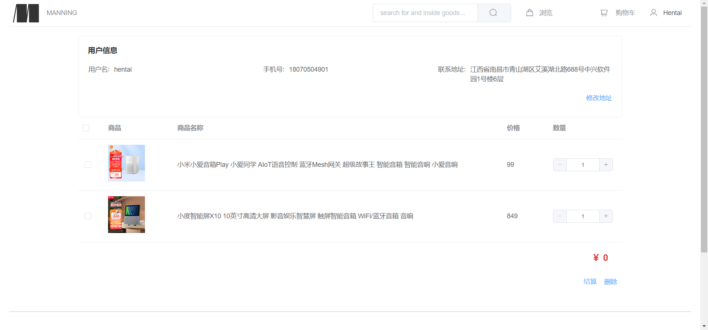
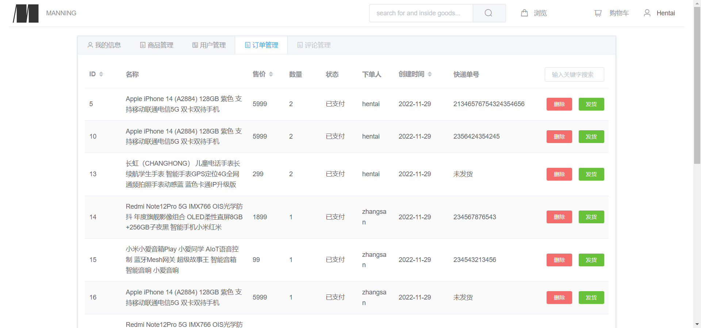
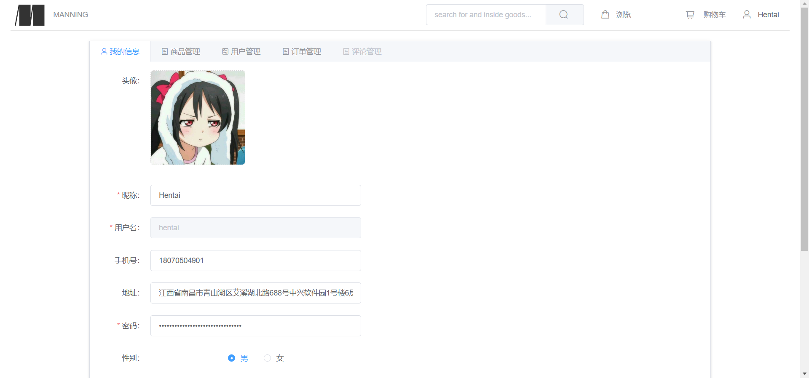
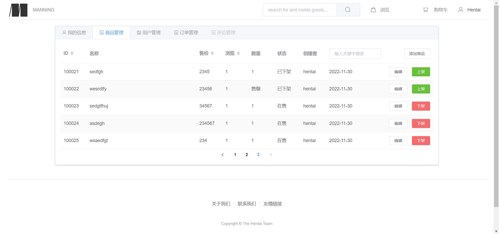
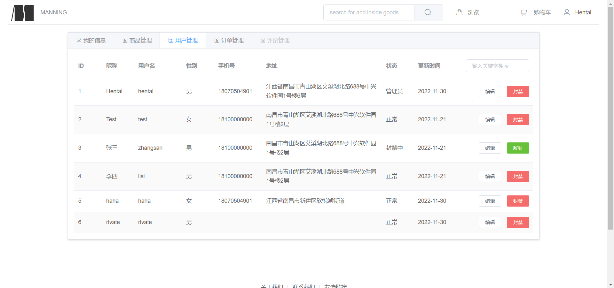

# spring-mybatis-demo

基于 Spring MVC + MyBatis 的电商演示项目。

## 技术栈

| 技术 | 版本 | 说明 |
|------|------|------|
| Spring MVC | 5.3.20 | Web 层框架 |
| Spring JDBC | 5.3.20 | 事务管理 |
| MyBatis | 3.5.10 | ORM 持久层框架 |
| MyBatis-Spring | 2.0.7 | Spring 与 MyBatis 整合 |
| Thymeleaf | 3.0.15 | 服务端模板引擎 |
| MySQL | 8.x | 关系型数据库 |
| DBCP | 1.4 | 数据库连接池 |
| Vue.js + Element UI | - | 前端交互框架 |
| FastJSON | 1.2.76 | JSON 序列化 |
| Maven | - | 项目构建管理 |

## 项目结构

```
src/
├── main/java/com/example/
│   ├── Generator.java                   # MyBatis 代码生成器入口
│   ├── controller/
│   │   ├── GoodsController.java         # 商品相关 REST API
│   │   ├── UserController.java          # 用户相关 REST API
│   │   ├── FileUploadController.java    # 文件上传接口
│   │   ├── PagePathController.java      # 页面路由（Thymeleaf 视图）
│   │   └── HelloWorld.java              # 测试端点
│   ├── mapper/
│   │   ├── GoodsMapper.java             # 商品 DAO
│   │   ├── UserMapper.java              # 用户 DAO
│   │   ├── ShopCartMapper.java          # 购物车/订单 DAO
│   │   ├── GoodsCommentMapper.java      # 商品评论 DAO
│   │   ├── GoodsCoverMapper.java        # 商品图片 DAO
│   │   └── GoodsSubCategoryMapper.java  # 商品子分类 DAO
│   ├── pojo/
│   │   ├── Goods.java                   # 商品实体
│   │   ├── User.java                    # 用户实体
│   │   ├── ShopCart.java               # 购物车实体
│   │   ├── GoodsComment.java           # 商品评论实体
│   │   ├── GoodsCover.java             # 商品图片实体
│   │   ├── GoodsSubcategory.java       # 商品子分类实体
│   │   ├── BaseResponse.java           # 统一 API 响应封装
│   │   ├── RestView.java               # 自定义 JSON 视图
│   │   └── UploadInfo.java             # 文件上传信息
│   └── util/
│       ├── WebUtil.java                # HTTP 工具类
│       └── Util.java                   # 通用工具类
├── main/resources/
│   ├── spring-mvc.xml                  # Spring MVC 配置
│   ├── spring-mybatis.xml              # Spring + MyBatis 整合配置
│   ├── jdbc.properties                 # 数据库连接配置
│   ├── log4j.properties                # 日志配置
│   ├── generatorConfig.xml             # MyBatis Generator 配置
│   ├── mapper/                         # MyBatis SQL 映射 XML 文件
│   └── templates/                      # Thymeleaf 页面模板
└── webapp/
    ├── WEB-INF/web.xml                 # Servlet 部署描述符
    ├── css/                            # 样式文件
    ├── js/                             # JavaScript 文件
    ├── img/                            # 静态图片
    ├── data/                           # 商品图片与用户头像
    ├── tmp/                            # 临时上传目录
    └── element-ui/                     # Element UI 组件库
```

## 功能模块

### 用户模块
- 用户注册与登录（密码 MD5 加密存储）
- 个人信息管理（昵称、地址、电话、头像上传）
- 用户状态管理（管理员可封禁/解封用户）
- 基于 Session 的身份认证

### 商品模块
- 商品分类浏览（一级分类 + 二级子分类）
- 商品详情展示（图片轮播、评论）
- 商品搜索
- 热门商品推荐 / 猜你喜欢
- 商品管理（管理员：上架、下架、编辑、删除）

### 购物与订单
- 购物车（添加、修改数量、删除）
- 订单结算（模拟支付）
- 订单列表查看

### 评论模块
- 商品评论发表
- 评论列表展示

### 文件上传
- 用户头像上传
- 商品图片上传

## 项目截图

| 首页 | 商品分类 |
|------|----------|
|  |  |

| 商品详情 | 购物车 |
|----------|--------|
|  |  |

| 订单管理 | 用户信息 |
|----------|----------|
|  |  |

| 商品管理（管理员） | 用户管理（管理员） |
|-------------------|-------------------|
|  |  |

## 快速开始

### 环境要求

- JDK 8+
- Maven 3.6+
- MySQL 5.7+
- Servlet 容器（Tomcat 9+）

### 数据库初始化

1. 创建数据库：

```sql
CREATE DATABASE `example` DEFAULT CHARACTER SET utf8mb4;
```

2. 导入表结构与示例数据：

```bash
mysql -u root -p example < example.sql
```

3. 修改数据库连接配置（如需要）：编辑 `src/main/resources/jdbc.properties`

```properties
jdbc.driver=com.mysql.cj.jdbc.Driver
jdbc.url=jdbc:mysql://localhost:3306/example?useUnicode=true&characterEncoding=utf-8
jdbc.username=root
jdbc.password=123456
```

### 构建与部署

```bash
# 编译打包
mvn clean package

# 将 target/spring-mybatis-demo-1.0-SNAPSHOT.war 部署到 Tomcat 的 webapps 目录
# 启动 Tomcat 后访问: http://localhost:8080/spring-mybatis-demo-1.0-SNAPSHOT/app/
```

### 测试账号

| 角色 | 用户名 | 密码 |
|------|--------|------|
| 管理员 (ID=1) | admin | 123456 |
| 普通用户 | hentai | 123456 |

## API 接口概览

### 用户接口 (`/user/`)

| 路径 | 方法 | 说明 |
|------|------|------|
| `/user/reg.do` | POST | 用户注册 |
| `/user/login.do` | POST | 用户登录 |
| `/user/logout.do` | GET | 退出登录 |
| `/user/getUserInfo.do` | GET | 获取当前用户信息 |
| `/user/getAllUser.do` | GET | 获取所有用户（管理员） |
| `/user/updateUserInfo.do` | POST | 更新用户信息 |
| `/user/updateUserAddress.do` | POST | 更新地址/电话 |
| `/user/changeUserStatus.do` | POST | 修改用户状态（管理员） |

### 商品接口 (`/goods/`)

| 路径 | 方法 | 说明 |
|------|------|------|
| `/goods/querySubCategory.do` | GET | 查询子分类 |
| `/goods/queryGoods.do` | GET | 按子分类查询商品 |
| `/goods/likeGoods.do` | GET | 猜你喜欢 |
| `/goods/queryHotGoods.do` | GET | 热门商品 |
| `/goods/getAllGoods.do` | GET | 所有商品（管理员） |
| `/goods/getGoods.do` | GET | 商品详情 |
| `/goods/delGoods.do` | POST | 删除商品（管理员） |
| `/goods/changeGoodsStatus.do` | POST | 上架/下架商品（管理员） |
| `/goods/updateGoodsInfo.do` | POST | 编辑商品（管理员） |
| `/goods/insertGoods.do` | POST | 新增商品（管理员） |
| `/goods/searchGoods.do` | GET | 搜索商品 |
| `/goods/addComment.do` | POST | 发表评论 |
| `/goods/addCart.do` | POST | 加入购物车 |
| `/goods/queryCart.do` | GET | 查看购物车 |
| `/goods/delCart.do` | POST | 从购物车删除 |
| `/goods/settlement.do` | POST | 订单结算 |

### 文件上传 (`/file/`)

| 路径 | 方法 | 说明 |
|------|------|------|
| `/file/uploadFile.do` | POST | 上传文件 |

## 统一响应格式

```json
{
  "status": 0,
  "reason": "操作成功",
  "data": {}
}
```

- `status`: 0 成功，1 失败
- `reason`: 状态描述
- `data`: 响应数据（可选）

## 注意事项

- 密码使用 MD5 哈希存储，**生产环境应替换为更强的哈希算法**（如 BCrypt）
- 文件上传依赖 `webapp/tmp/` 和 `webapp/data/` 目录，需确保可写
- 数据库采用软删除设计，`is_del` 字段 0 表示正常
- 本项目为传统 Spring 项目（非 Spring Boot），需部署到外部 Servlet 容器
